<div align="center">

# ⛏️ BlockCraft

**Klon Minecrafta 1.8 napisany od zera w C# / .NET 8 i OpenGL 3.3**

Bez jednego pliku z grafiką – wszystkie tekstury, modele mobów, font i GUI są generowane proceduralnie w kodzie.


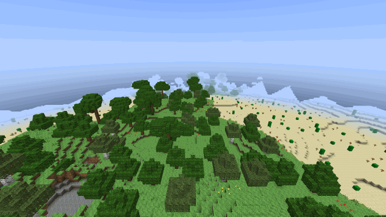

*Przelot w trybie kreatywnym nad lasem i pustynią – każdy kadr to prawdziwa klatka z gry.*

[Galeria](#-galeria) · [Zrzuty ekranu](#-zrzuty-ekranu) · [Funkcje](#-funkcje) · [Sterowanie](#-sterowanie) · [Uruchomienie](#-uruchomienie) · [Architektura](#-architektura) · [Roadmapa](#-roadmapa)

</div>

---

## ✨ W skrócie

| | |
|---|---|
| 🌍 **Nieskończony świat** | Szum Perlina, biomy las i pustynia, jaskinie, rudy, drzewa, woda na poziomie morza |
| ☀️ **Oświetlenie jak w MC** | Sky light + block light (BFS), smooth lighting, ambient occlusion, cykl dnia i nocy |
| 🧱 **Pełny survival** | Kopanie wg twardości/narzędzia, crafting 2×2 i 3×3, piec, skrzynie, głód, obrażenia, śmierć |
| 🐄 **Moby z AI** | 9 mobów, pathfinding A*, spawnowanie w ciemności, rozmnażanie, płonięcie w słońcu |
| 🔴 **Redstone** | Pył, pochodnie, dźwignie, przyciski, repeatery, lampy, tłoki (też lepkie), TNT, drzwi |
| 🎨 **Zero assetów** | Pixel-artowe tekstury 16×16, skiny mobów i font z polskimi znakami generowane w kodzie |

---

## 🎬 Galeria

<table>
  <tr>
    <td align="center" width="50%">
      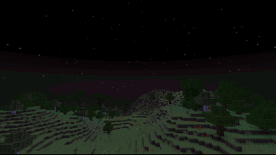<br>
      <b>Cykl dnia i nocy</b><br>
      <sub>Wschód słońca, niebo z gradientem, gwiazdy i księżyc w fazach</sub>
    </td>
    <td align="center" width="50%">
      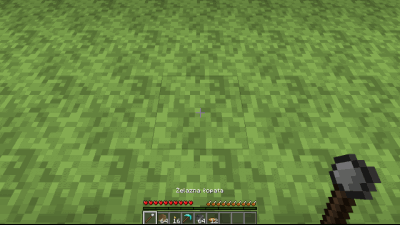<br>
      <b>Kopanie i budowanie</b><br>
      <sub>Pękanie bloków, cząsteczki, dropy, animacja ręki, HUD przetrwania</sub>
    </td>
  </tr>
  <tr>
    <td align="center">
      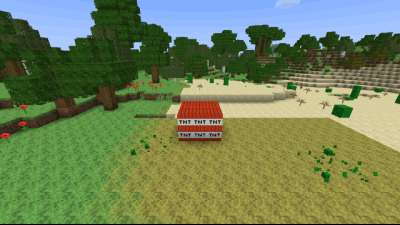<br>
      <b>TNT</b><br>
      <sub>Zapalnik, reakcja łańcuchowa, krater i dym</sub>
    </td>
    <td align="center">
      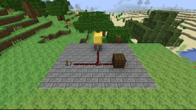<br>
      <b>Redstone</b><br>
      <sub>Dźwignia → pył → lampa i lepki tłok z blokiem złota</sub>
    </td>
  </tr>
  <tr>
    <td align="center">
      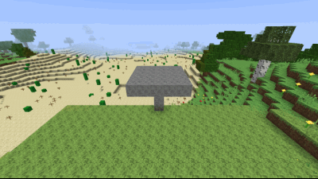<br>
      <b>Płyny</b><br>
      <sub>Źródło wody rozlewa się po platformie i spływa wodospadem</sub>
    </td>
    <td align="center">
      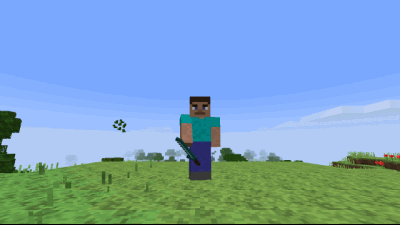<br>
      <b>Steve w trzeciej osobie (F5)</b><br>
      <sub>Model z boxów z UV jak w skinach MC, zbroja i trzymany item</sub>
    </td>
  </tr>
  <tr>
    <td align="center">
      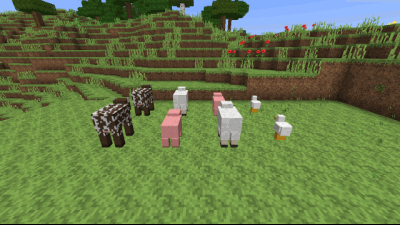<br>
      <b>Zwierzęta</b><br>
      <sub>Krowy, świnie, owce i kurczaki z AI wędrowania</sub>
    </td>
    <td align="center">
      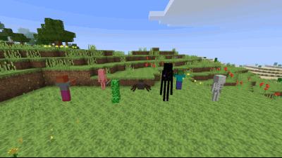<br>
      <b>Potwory</b><br>
      <sub>Zombie, szkielet, creeper, pająk i enderman</sub>
    </td>
  </tr>
  <tr>
    <td align="center" colspan="2">
      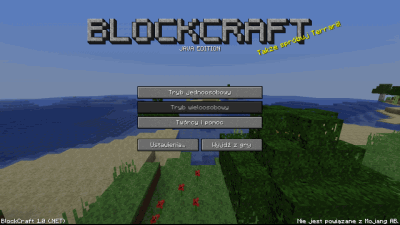<br>
      <b>Menu główne</b><br>
      <sub>Obracająca się panorama na żywo renderowanego świata w tle</sub>
    </td>
  </tr>
</table>

---

## 📸 Zrzuty ekranu

<table>
  <tr>
    <td>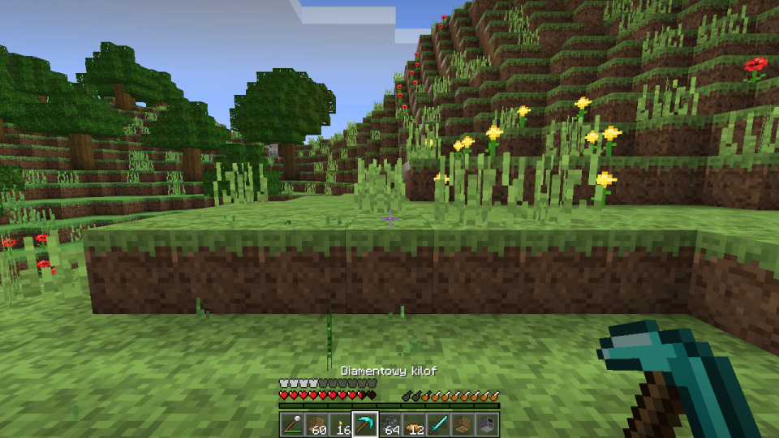</td>
    <td>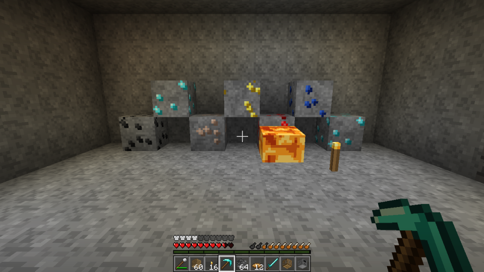</td>
    <td>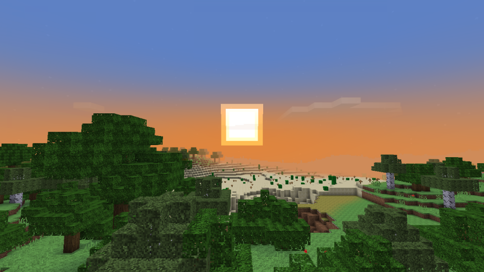</td>
  </tr>
  <tr>
    <td align="center"><sub>HUD przetrwania – serca, głód, zbroja, hotbar</sub></td>
    <td align="center"><sub>Rudy, lawa i oświetlenie pochodni pod ziemią</sub></td>
    <td align="center"><sub>Zachód słońca nad lasem i pustynią</sub></td>
  </tr>
  <tr>
    <td>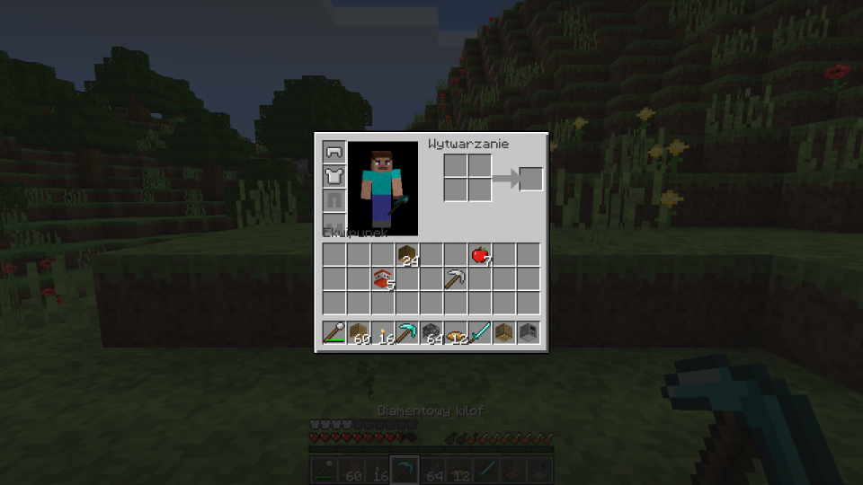</td>
    <td>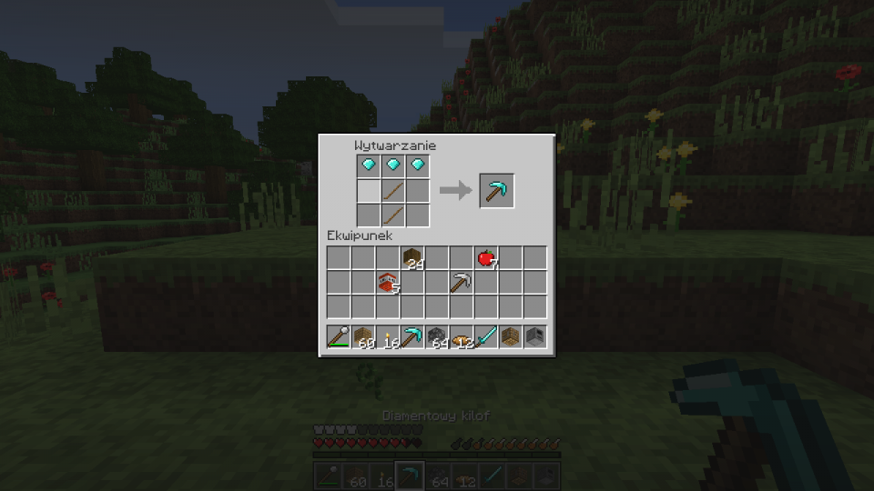</td>
    <td>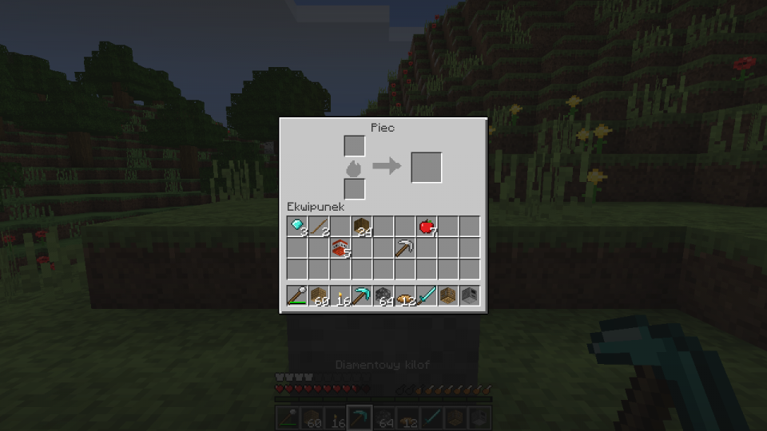</td>
  </tr>
  <tr>
    <td align="center"><sub>Ekwipunek z podglądem gracza i zbroją</sub></td>
    <td align="center"><sub>Crafting 3×3 – diamentowy kilof</sub></td>
    <td align="center"><sub>Piec: paliwo, przetapianie, pieczenie</sub></td>
  </tr>
  <tr>
    <td>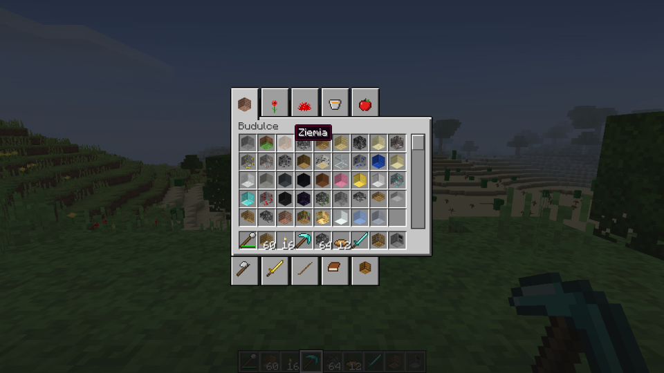</td>
    <td>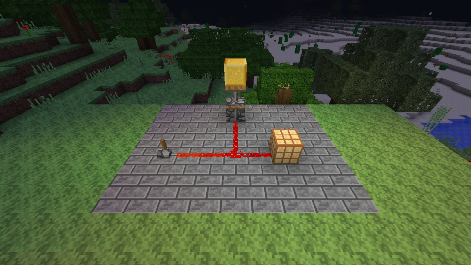</td>
    <td>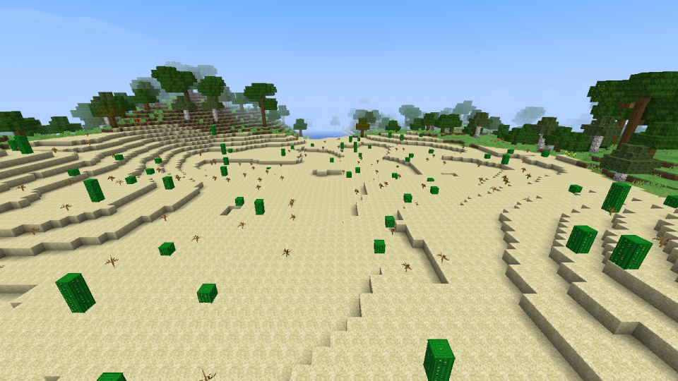</td>
  </tr>
  <tr>
    <td align="center"><sub>Menu kreatywne z zakładkami</sub></td>
    <td align="center"><sub>Zapalona lampa redstone w nocy</sub></td>
    <td align="center"><sub>Biom pustyni z kaktusami i martwymi krzakami</sub></td>
  </tr>
  <tr>
    <td>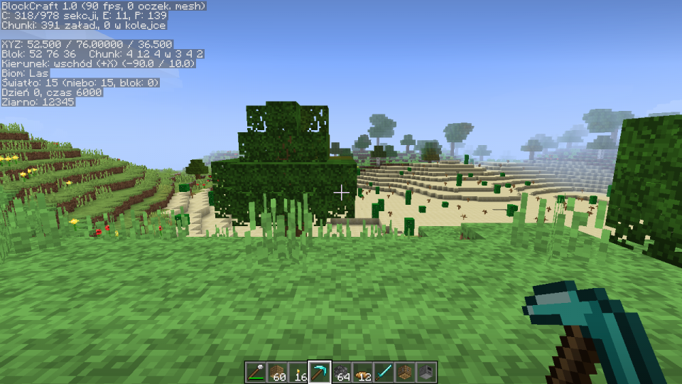</td>
    <td>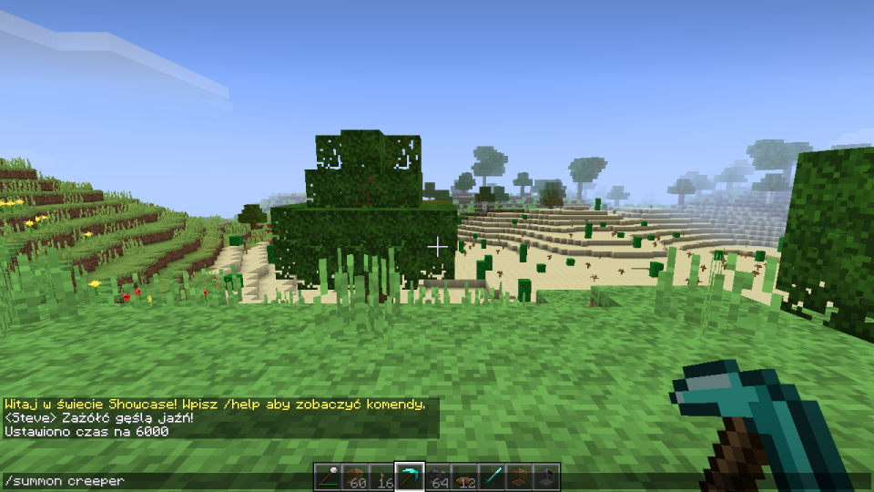</td>
    <td>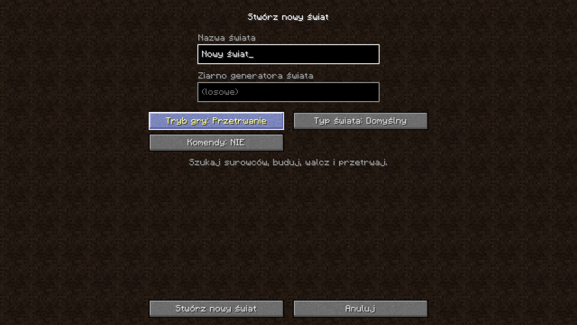</td>
  </tr>
  <tr>
    <td align="center"><sub>Ekran debug (F3)</sub></td>
    <td align="center"><sub>Czat i komendy – z polskimi znakami</sub></td>
    <td align="center"><sub>Tworzenie świata: tryb, typ, ziarno</sub></td>
  </tr>
</table>

---

## 🧩 Funkcje

<details open>
<summary><b>🌍 Świat</b></summary>

- Rejestr bloków (id + metadata), chunki 16×128×16 dzielone na sekcje 16³
- Generator terenu: szum Perlina (oktawy), biomy **las** i **pustynia**, plaże, woda na poziomie 63, jaskinie, bedrock
- Rudy: węgiel, żelazo, złoto, redstone, lapis, diament
- Drzewa (dąb, brzoza) jak w MC, kwiaty, trawa, kaktusy, martwe krzaki, trzcina
- Świat superpłaski
- Oświetlenie: sky light + block light (BFS), smooth lighting + ambient occlusion
- Mesher sekcji w wątkach w tle, frustum culling, mgła
- Niebo, słońce, księżyc, gwiazdy, cykl dnia i nocy, chmury 3D
- Woda i lawa (płynięcie, źródła), animowane tekstury
- Zapis i odczyt świata

</details>

<details>
<summary><b>🏃 Gracz</b></summary>

- Fizyka jak w MC: grawitacja, tarcie, skok, kolizje AABB
- Sprint (Ctrl / 2× W), kucanie (Shift, z trzymaniem się krawędzi)
- Pływanie, drabiny, latanie w kreatywnym (2× spacja)
- Kamera F5: pierwsza osoba, trzecia z tyłu, trzecia z przodu; bobbing, ręka Steve'a z trzymanym itemem
- Niszczenie bloków z czasem zależnym od twardości i narzędzia, pęknięcia, cząsteczki; stawianie bloków
- Zdrowie, głód, nasycenie, wyczerpanie, regeneracja
- Obrażenia od upadku, topienia, lawy i kaktusa; śmierć i respawn
- Jedzenie (jabłka, mięso surowe/pieczone, chleb…) z animacją

</details>

<details>
<summary><b>🎒 Itemy i GUI</b></summary>

- Ekwipunek: 36 slotów + zbroja, hotbar, klik L/P, shift-klik, przeciąganie, klawisze 1–9, Q
- Crafting 2×2 w ekwipunku i 3×3 na stole, receptury shaped i shapeless
- Piec (paliwo, przetapianie, pieczenie) i skrzynia
- Narzędzia drewno → kamień → żelazo → diament (+ złoto), miecze, motyki, nożyce, wiadra, zbroje
- Menu kreatywne z zakładkami i wszystkimi itemami
- HUD: celownik, hotbar, serca, głód, zbroja, bąbelki powietrza, XP, ekran debug F3
- Menu główne z panoramą świata, wybór i tworzenie świata, ustawienia grafiki, sterowanie, pauza, ekran śmierci
- Czat z komendami i podpowiadaniem (Tab)

</details>

<details>
<summary><b>🐷 Moby</b></summary>

- Renderer modeli z boxów (UV jak w skinach MC), proceduralne tekstury mobów
- AI + pathfinding A*, spawnowanie (światło ≤ 7, noc i jaskinie), despawn
- **Potwory:** zombie, szkielet (łuk i strzały), creeper (eksplozja), pająk (wspinanie), enderman (teleport, reakcja na wzrok)
- Zombie i szkielety płoną w słońcu
- **Zwierzęta:** krowa (mleko, skóra), owca (wełna, strzyżenie, odrastanie), świnia, kurczak (jajka) – z rozmnażaniem i młodymi
- Dropy, łuk gracza, TNT

</details>

<details>
<summary><b>🔴 Redstone</b></summary>

- Pył redstone, pochodnia, dźwignia, przycisk, blok redstone, lampa, repeater
- TNT, tłok i lepki tłok, drzwi

</details>

---

## 🎮 Sterowanie

| Klawisz | Akcja | | Klawisz | Akcja |
|---|---|---|---|---|
| <kbd>W</kbd> <kbd>A</kbd> <kbd>S</kbd> <kbd>D</kbd> | Ruch | | <kbd>E</kbd> | Ekwipunek / menu kreatywne |
| <kbd>Spacja</kbd> | Skok · 2× – latanie (kreatywny) | | <kbd>Q</kbd> | Wyrzuć przedmiot |
| <kbd>Shift</kbd> | Kucanie | | <kbd>T</kbd> / <kbd>/</kbd> | Czat / komenda |
| <kbd>Ctrl</kbd> / 2× <kbd>W</kbd> | Sprint | | <kbd>F1</kbd> | Ukryj HUD |
| <kbd>LPM</kbd> | Niszczenie / atak | | <kbd>F2</kbd> | Zrzut ekranu |
| <kbd>PPM</kbd> | Stawianie / użycie | | <kbd>F3</kbd> | Ekran debug |
| <kbd>ŚPM</kbd> | Wybierz blok | | <kbd>F5</kbd> | Zmiana kamery |
| <kbd>1</kbd>–<kbd>9</kbd> / kółko | Slot hotbara | | <kbd>F11</kbd> | Pełny ekran |

### 💬 Komendy

Dostępne w światach z włączonymi kodami:

| Komenda | Opis |
|---|---|
| `/time set <day\|noon\|night\|midnight\|liczba>` | Zmiana pory dnia |
| `/gamemode <survival\|creative\|spectator>` | Tryb gry (`/gm`) |
| `/tp`, `/spawnpoint`, `/setworldspawn` | Teleport i punkty odrodzenia |
| `/give <item> [ilość]`, `/clear` | Przedmioty |
| `/summon <mob> [x y z]`, `/kill` | Moby |
| `/setblock`, `/fill` | Edycja świata |
| `/difficulty`, `/gamerule` | Trudność i reguły (np. `doDaylightCycle`) |
| `/xp`, `/heal`, `/feed` | Gracz |
| `/seed`, `/say`, `/me`, `/list`, `/help` | Pozostałe |

---

## 🚀 Uruchomienie

**Wymagania:** Windows, [.NET 8 SDK](https://dotnet.microsoft.com/download/dotnet/8.0), karta graficzna z OpenGL 3.3.

```bash
git clone https://github.com/fkliczewski/BlockCraft.git
cd BlockCraft/src/BlockCraft
dotnet run -c Release
```

Publikacja do jednego folderu:

```bash
dotnet publish src/BlockCraft -c Release -r win-x64 --self-contained -o BlockCraft_Gra
```

### Tryby uruchomienia

| Flaga | Co robi |
|---|---|
| *(brak)* | Normalna gra |
| `--selftest` | Testy logiki w konsoli (`SelfTest.cs`) |
| `--autotest` | Automatyczny przebieg gry ze zrzutami do weryfikacji wizualnej (`GameAutotest.cs`) |
| `--showcase` | Nagrywa sceny i zrzuty do tego README (`GameShowcase.cs`) |

Zapisy światów i zrzuty ekranu (F2) trafiają do `%APPDATA%\.blockcraft`.

---

## 🏗️ Architektura

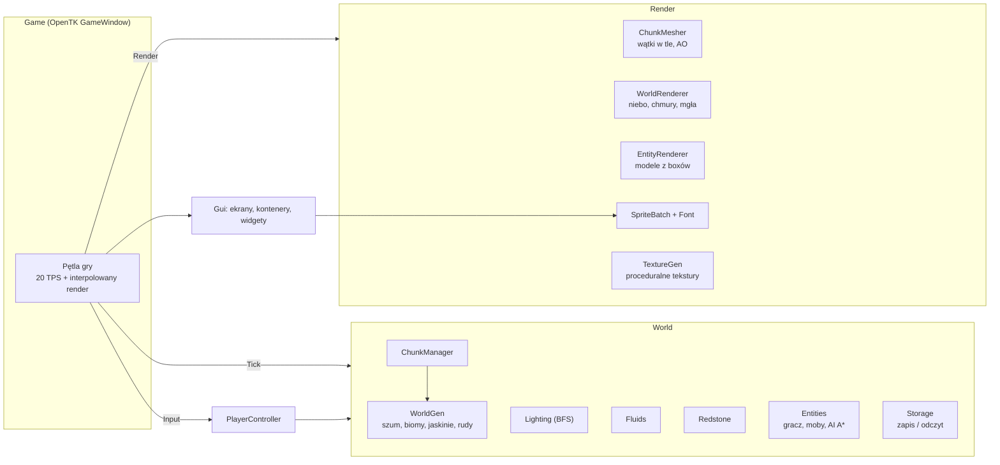

```
src/BlockCraft/
├── Core/         # matematyka, RNG, szum, logowanie, kierunki
├── World/        # bloki, chunki, generator, światło, płyny, redstone, zapis
├── Entities/     # gracz, moby, AI, pathfinding, spawner, TNT, eksplozje
├── Items/        # itemy, receptury, ekwipunek, tile entities
├── Render/       # OpenGL, mesher, renderery, tekstury proceduralne, font
├── Gui/          # ekrany menu, kontenery, widgety, tekstury GUI
├── Game*.cs      # okno, pętla, render HUD, autotest, showcase
└── Commands.cs   # komendy czatu
```

---

## 🎞️ Jak powstały media w README

Wszystkie GIF-y i zrzuty to prawdziwe klatki z gry, nagrane automatycznie:

```bash
# 1. nagraj sceny (klatki PNG do bin/Release/net8.0/showcase)
cd src/BlockCraft && dotnet build -c Release
bin/Release/net8.0/BlockCraft.exe --showcase

# 2. złóż GIF-y i zmniejszone zrzuty do docs/media
cd ../../tools/readme-media && npm install && npm run media
```

---

## 🗺️ Roadmapa

- [x] Fundament: okno, pętla gry, shadery, atlas tekstur, font
- [x] Świat: generator, biomy, oświetlenie, płyny, zapis
- [x] Gracz: fizyka, survival, kamera, jedzenie
- [x] Itemy i GUI: ekwipunek, crafting, piec, menu kreatywne, czat
- [x] Moby: AI, pathfinding, spawnowanie, rozmnażanie
- [x] Redstone
- [ ] 🌐 Multiplayer – host w grze + serwer dedykowany (`--server`) + klient TCP
- [ ] 🔊 Dźwięki syntezowane proceduralnie (NAudio)
- [ ] 🧪 Projekt testów xUnit (`BlockCraft.Tests`)

Szczegóły w [CHECKLISTA.md](CHECKLISTA.md).

---

<div align="center">
<sub>Projekt hobbystyczny. Nie jest powiązany z Mojang Studios ani Microsoft. Minecraft jest znakiem towarowym Mojang Synergies AB.</sub>
</div>
